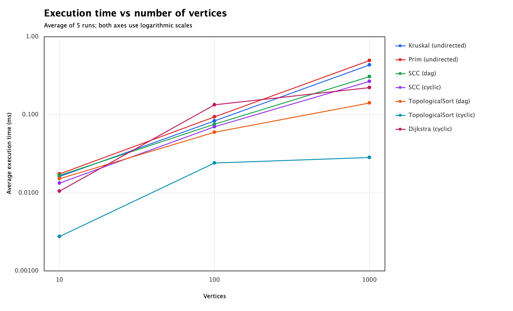
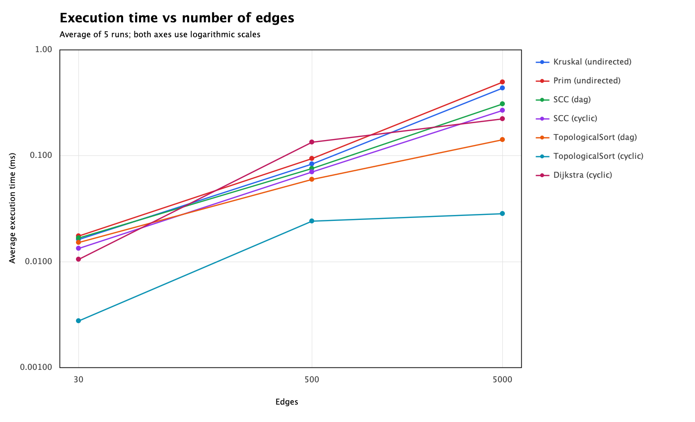

# Smart City Infrastructure and Route Planning

## 1. Overview

This Java application models a city's infrastructure as a weighted graph.

Vertices represent districts or locations. Edges represent roads or infrastructure connections. Edge weights represent construction costs or travel distances.

The application supports:

- Minimum-cost infrastructure planning with Kruskal's and Prim's algorithms.
- Connectivity analysis with strongly connected components.
- Dependency ordering with topological sorting.
- Route planning with Dijkstra's shortest-path algorithm.

The project uses Java 17, Maven, and JUnit 5.

## 2. Implementation

### Graph representation

The graph uses an adjacency list and a separate edge list.

Each edge stores its source vertex, destination vertex, and integer weight. Vertices are numbered from 0 to V - 1.

The graph supports both directed and undirected connections. For an undirected connection, the adjacency list stores both directions, while the separate edge list stores the connection once.

The adjacency list supports efficient neighbor traversal. The separate edge list is useful for Kruskal's algorithm and graph validation.

### Disjoint Set Union

DSU stores a parent and rank for each vertex.

The find operation uses path compression: visited vertices are connected directly to their component's root.

The union operation uses union by rank: the root of the lower-rank tree is attached to the higher-rank root. When the ranks are equal, one root becomes the parent and its rank increases.

These optimizations keep the trees shallow and make repeated operations efficient.

### Minimum spanning trees

Kruskal's algorithm sorts edges by weight. It uses DSU to add an edge only when its endpoints belong to different components.

Prim's algorithm starts at vertex 0 and uses a priority queue to choose the cheapest edge connecting the current tree to an unvisited vertex. Queue entries leading to visited vertices are discarded.

Both implementations return the selected edges. The total weight is calculated using long arithmetic.

Both algorithms reject directed graphs and report an error when a nonempty undirected graph is disconnected.

### Strongly connected components

Kosaraju's algorithm performs two DFS passes.

The first pass records vertices in finishing order. The algorithm then reverses all edges and performs another DFS pass in reverse finishing order.

Each DFS tree in the second pass represents one strongly connected component.

The implementation uses recursive DFS.

### Topological sorting

Kahn's algorithm calculates each vertex's in-degree and places vertices with zero in-degree into a queue.

After processing a vertex, it reduces the in-degrees of its neighbors.

If fewer than V vertices are processed, the graph contains a cycle and no topological ordering exists.

### Shortest paths

Dijkstra's algorithm uses a priority queue of vertex-distance pairs.

When a shorter route is found, the distance and predecessor are updated and a new queue entry is added. Outdated queue entries are skipped when removed.

Distances use long values. Long.MAX_VALUE represents an unreachable vertex. A predecessor array allows the algorithm to reconstruct paths.

All edge weights are checked before execution. Negative weights are rejected because they invalidate the standard greedy argument that a settled shortest distance cannot later improve.

## 3. Complexity Analysis

V denotes the number of vertices and E denotes the number of logical edges.

The graph representation requires O(V + E) space. The table below describes algorithm time and additional space, excluding the input graph.

| Algorithm | Time complexity | Additional space |
|---|---|---|
| DSU initialization | O(V) | O(V) |
| DSU find and union | O(alpha(V)) amortized per operation | O(V) for the DSU structure |
| Kruskal | O(V + E log(E + 1)) | O(V + E) |
| Prim | O(V + E log(E + 1)) | O(V + E) |
| Kosaraju SCC | O(V + E) | O(V + E) |
| Kahn topological sort | O(V + E) | O(V) |
| Dijkstra | O(V + E log(E + 1)) | O(V + E) |

alpha(V) is the inverse Ackermann function, which grows extremely slowly. The DSU bound is amortized over a sequence of operations.

Kruskal's runtime is dominated by sorting. Its extra space includes the copied edge list, DSU arrays, and selected edges.

The implemented versions of Prim and Dijkstra use binary heaps with potentially O(E) queued entries. They do not use an indexed heap with decrease-key. Therefore, log(E + 1) describes their heap operations directly. On simple connected graphs, their time bounds are commonly expressed as O(E log V).

Kosaraju examines every edge in each DFS pass and constructs a reversed graph. Recursive DFS can require O(V) stack space.

Topological sorting maintains an in-degree array, a queue, and the output ordering.

Dijkstra's initialization and negative-weight validation are included in its bound. Reconstructing one path takes O(V) time in the worst case and is performed separately from the benchmark.

## 4. Experimental Setup

### Graph sizes

| Configuration | Vertices | Edges |
|---|---:|---:|
| Small | 10 | 30 |
| Medium | 100 | 500 |
| Large | 1000 | 5000 |

All generators use the fixed seed 42. Weights are integers from 1 to 100.

Generated graphs have no self-loops or duplicate connections. Equal edge weights are allowed.

### Generation methods

**Connected undirected graphs:** each vertex after vertex 0 is first connected to a randomly selected earlier vertex. This creates a spanning tree. Additional unique edges are added until the required edge count is reached.

**Directed acyclic graphs:** every edge goes from a smaller vertex number to a larger one. A directed cycle is therefore impossible.

**Directed cyclic graphs:** a directed ring through all vertices is created first. Additional unique directed edges are then added. The ring guarantees that the graph is strongly connected and contains a cycle.

These generators provide reproducible examples, rather than a uniform sample of all possible graphs.

### Measurement procedure

Each algorithm and graph configuration receives 20 warmup runs followed by 5 measured runs.

Execution time is measured using System.nanoTime(). The arithmetic mean of the five measurements is reported.

Graph generation, correctness checks, console output, and CSV writing occur outside the timed section.

Algorithm initialization, internal allocations, and operation counters are included. Dijkstra's path reconstruction is excluded.

For topological sorting on cyclic graphs, the measurement includes cycle detection and exception creation.

The experiments use one graph per size and graph type. Repeated runs measure the same graph rather than five independently generated graphs.

The runtime environment is recorded in:

[Environment](results/tables/environment.txt)

## 5. Results

### Average execution time

All values below are in milliseconds.

| Algorithm | Graph type | V=10, E=30 | V=100, E=500 | V=1000, E=5000 |
|---|---|---:|---:|---:|
| Kruskal | Undirected | 0.012216 | 0.083867 | 0.635092 |
| Prim | Undirected | 0.020858 | 0.095100 | 0.527217 |
| SCC | DAG | 0.018167 | 0.110417 | 0.420592 |
| SCC | Cyclic | 0.012558 | 0.074633 | 0.383633 |
| Topological sort | DAG | 0.006508 | 0.059867 | 0.179967 |
| Topological sort | Cyclic | 0.002883 | 0.024500 | 0.028275 |
| Dijkstra | Cyclic | 0.012109 | 0.118075 | 0.485717 |

### Operation counts

The benchmark records the following counters for every measured run:

| Counter | Definition |
|---|---|
| edge_examinations | Edge records examined in explicit algorithm loops, including validation or graph reversal where applicable |
| comparisons | Comparator calls during edge sorting or priority-queue operations |
| find_calls | DSU find invocations, including recursive calls |
| union_calls | Successful DSU merges |
| queue_pushes | Queue insertions |
| queue_pops | Queue removals |

These counters measure selected operations rather than every instruction.

Several counts follow directly from the implementation and generated graph properties:

| Operation | Small | Medium | Large |
|---|---:|---:|---:|
| Kruskal successful unions | 9 | 99 | 999 |
| SCC edge examinations, either graph type | 90 | 1500 | 15000 |
| Topological sort edge examinations, DAG | 60 | 1000 | 10000 |
| Topological sort edge examinations, cyclic ring-based graph | 30 | 500 | 5000 |
| Dijkstra edge examinations, cyclic graph | 60 | 1000 | 10000 |

SCC examines edges during two traversals and graph reversal, giving 3E examinations.

Topological sorting on a DAG examines edges during in-degree calculation and queue processing, giving 2E examinations.

In the generated cyclic graphs, every vertex has positive in-degree. The queue starts empty, so only the E examinations for in-degree calculation occur.

Dijkstra validates all E weights and then examines all E directed edges, because every vertex is reachable.

Kruskal's sorted-edge examinations, sorting comparisons, DSU find calls, and Prim's heap operations depend on the generated edges and weights. Their exact recorded values are available in the result tables:

- [Average times and operation counts](results/tables/summary.csv)
- [All 105 measured runs](results/tables/raw_results.csv)

### Plots





Both plots use logarithmic axes.

## 6. Comparison and Discussion

### Kruskal versus Prim

Kruskal was faster on the small and medium configurations. Prim was faster on the large configuration.

For V=1000 and E=5000, Kruskal took 0.635092 ms and Prim took 0.527217 ms. Prim's measured time was approximately 17.0% lower in this experiment.

Kruskal sorts the complete edge list and performs DSU operations. Prim maintains a priority queue while expanding the tree.

Their counters describe different work. Kruskal processes logical edges stored once, while Prim traverses adjacency lists where undirected edges appear in both directions. Comparator calls measure sorting work for Kruskal and heap work for Prim.

The measured results do not establish that one algorithm is always faster. Performance also depends on graph structure, edge weights, implementation details, and JVM behavior.

### DSU optimizations

Path compression shortens future searches by connecting vertices directly to their component root.

Union by rank prevents repeated merging from creating unnecessarily tall trees.

Together, these optimizations provide the amortized O(alpha(V)) bound. The project does not benchmark an unoptimized DSU, so no numerical speedup over an unoptimized version is claimed.

### SCC

SCC runtime increased with graph size for both DAGs and cyclic graphs.

Both cases have the same 3E edge-examination count in this implementation. Their elapsed times can still differ because DFS traversal structure, component allocation, and runtime effects differ.

The results are compatible with linear traversal work, but three configurations do not prove an asymptotic bound.

### Topological sorting

DAG processing visits every vertex and processes every edge after calculating in-degrees.

Cycle detection is faster for the generated cyclic graphs because the initial directed ring gives every vertex a positive in-degree. No vertex enters the queue.

This is a property of these inputs. Other cyclic graphs may allow part of the graph to be processed before a cycle is detected.

### Dijkstra

Dijkstra's average runtime increased as the graph grew.

The algorithm examines outgoing edges and performs heap operations when distances improve. Outdated entries are removed and skipped.

Although every generated cyclic graph is strongly connected, the number of successful distance improvements and heap operations depends on its weights and connections.

### Measurement limitations

The measurements are short and can be affected by JIT compilation, garbage collection, scheduling, and other activity.

Operation counting adds overhead. Five runs provide a basic classroom comparison rather than a rigorous microbenchmark.

The required configurations increase V and E together. The two plots therefore do not isolate the independent effect of vertices and edges.

## 7. Testing

The JUnit suite contains 13 tests covering:

- Expected MST weights on a small connected graph.
- Disconnected graphs.
- Multiple valid MSTs and equal edge weights.
- Single-vertex graphs.
- Topological ordering checked against every edge.
- Cycle detection during topological sorting.
- Expected SCC membership.
- Each vertex appearing in exactly one SCC.
- Isolated vertices.
- Correct Dijkstra distances and a reconstructed path.
- Unreachable vertices.
- Rejection of negative weights.
- Zero-weight and undirected shortest paths.
- DSU merging and already-connected vertices.

Some test methods cover more than one condition.

For multiple valid MSTs, the tests compare weights and edge counts rather than requiring identical selected edges.

SCC results are compared as sets because component ordering is not part of correctness.

The benchmark also checks MST weight agreement and the expected properties of generated directed graphs before timing.

### Running the project

Open pom.xml as a Maven project in IntelliJ IDEA and select JDK 17.

Run these classes:

1. org.example.Main — demonstration examples.
2. org.example.experiments.Benchmark — measurements and CSV tables.
3. org.example.experiments.PlotResults — PNG plots.

Run AlgorithmsTest to execute the JUnit suite.

Alternatively, from the project root with Maven installed:

```bash
mvn clean test
java -cp target/classes org.example.Main
java -cp target/classes org.example.experiments.Benchmark
java -cp target/classes org.example.experiments.PlotResults
```

Run the commands from the project root so that relative paths resolve correctly.

### Project packages

| Package | Purpose |
|---|---|
| org.example.graph | Graph representation and generation |
| org.example.dsu | Disjoint Set Union |
| org.example.mst | Kruskal and Prim |
| org.example.connectivity | SCC and topological sorting |
| org.example.shortestpath | Dijkstra |
| org.example.metrics | Operation counters |
| org.example.experiments | Benchmarking and plotting |

## 8. Conclusion

Kruskal and Prim solve minimum-cost infrastructure connection problems. Both return the same minimum total weight for the tested connected undirected graphs.

SCC identifies groups of locations with mutual directed reachability. Topological sorting orders dependencies when the directed graph is acyclic.

Dijkstra finds shortest routes from a selected source when edge weights are non-negative and reports unreachable locations.

The experiments show increasing execution times as the tested graphs grow. Prim was faster on the largest MST configuration, while Kruskal was faster on the two smaller configurations. The appropriate algorithm depends on the planning task and graph properties.